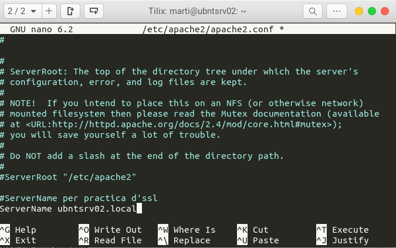
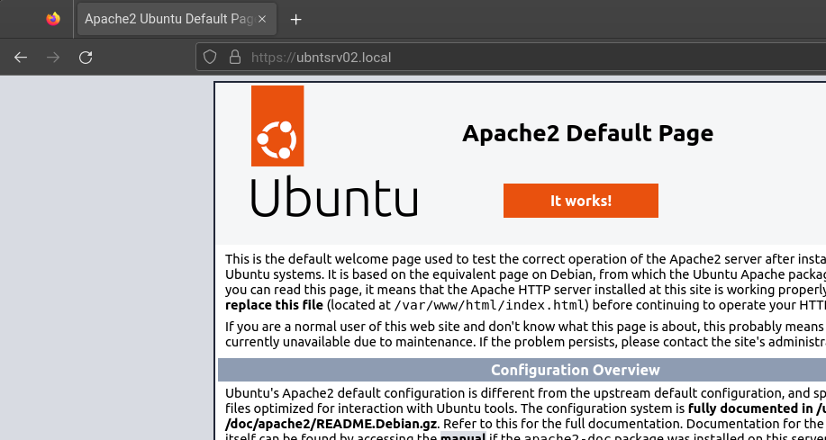

# Activitat 2.5 (continuació) — Configuració del servei Apache amb HTTPS


> **Cicle:** GS · **Curs:** 2n · **Especialitat:** ASIX  
> **Mòdul:** Seguretat i Alta disponibilitat · **Unitat:** UD2. Criptografia  
> **Autor/a:** Martí Vich · **Data:** 2026-10-22

## Objectius

- Instal·lar i habilitar Apache a Ubuntu Server.
- Configurar un VirtualHost HTTPS amb un certificat signat per la CA de l’activitat anterior.
- Comprovar que el certificat, la clau privada i el nom del servidor coincideixen.
- Validar la configuració i accedir al lloc mitjançant HTTPS.

## Context i situació

A la part anterior s’ha creat una CA i s’ha signat un certificat per a `ubntsrv02.local`. Ara configurarem aquest servidor Ubuntu com a servidor web Apache i utilitzarem el certificat per servir la pàgina per HTTPS.

## Requisits previs

- Un servidor Ubuntu amb el nom `ubntsrv02.local` resoluble des del client (mitjançant DNS o el fitxer `hosts`).
- Accés amb `sudo` al servidor.
- El certificat `ubntsrv02.local.crt` i la clau privada corresponent `ubntsrv02.local.key`.
- La CA arrel `myCA.pem` instal·lada com a autoritat de confiança al client, tal com s’explica a l’activitat anterior.

> **Seguretat:** transfereix la clau privada al servidor de manera segura. No la publiquis ni la pugis a GitHub. El certificat `.crt` és públic; el fitxer `.key` és secret.

## Enunciat

Instal·la Apache, permet el trànsit web al tallafoc i configura un VirtualHost que escolti al port 443. El servidor ha de presentar el certificat signat per la CA i respondre a `https://ubntsrv02.local` sense errors de confiança ni de nom.

La identitat HTTPS es comprova amb el **SAN** del certificat. Per tant, `ubntsrv02.local` ha d’aparèixer com a nom DNS al SAN i el client ha d’accedir amb aquest mateix nom. `ServerName` selecciona/descriu el VirtualHost; no substitueix el control del nom del certificat.

## Tasques

### 1. Instal·lar Apache i obrir el tallafoc

Actualitza la informació dels paquets i instal·la Apache:

```bash
sudo apt update
sudo apt install apache2
```

Permet els perfils HTTP i HTTPS d’Apache a UFW:

```bash
sudo ufw allow "Apache Full"
sudo ufw status
```

El perfil `Apache Full` permet les connexions web HTTP i HTTPS. Comprova que, abans d’activar HTTPS, pots obrir `http://ubntsrv02.local` des del client.


La connexió HTTP no està xifrada. La icona del navegador pot indicar que la connexió no és segura; en aquesta primera comprovació encara no estem provant HTTPS.


### 2. Habilitar el mòdul TLS d’Apache

El mòdul es diu `mod_ssl` per motius històrics; avui configurem HTTPS amb TLS:

```bash
sudo a2enmod ssl
sudo systemctl restart apache2
```

### 3. Instal·lar el certificat i protegir la clau

Copia prèviament els dos fitxers al servidor mitjançant un canal segur. Després, des del directori on els hagis deixat, instal·la’ls amb permisos explícits:

```bash
sudo install -o root -g root -m 0644 \
  ubntsrv02.local.crt /etc/ssl/certs/ubntsrv02.local.crt

sudo install -o root -g root -m 0600 \
  ubntsrv02.local.key /etc/ssl/private/ubntsrv02.local.key
```

El certificat conté la clau pública. La clau privada del servidor queda llegible només per `root`; Apache llegeix la clau durant l’inici o la recàrrega del servei.

### 4. Crear el directori del lloc web

Crea el `DocumentRoot` i copia-hi la pàgina de prova d’Apache:

```bash
sudo mkdir -p /var/www/ubntsrv02.local
sudo cp -a /var/www/html/. /var/www/ubntsrv02.local/
```

### 5. Configurar el VirtualHost HTTPS

Crea el fitxer `/etc/apache2/sites-available/ubntsrv02.local.conf`:

```bash
sudo nano /etc/apache2/sites-available/ubntsrv02.local.conf
```

Afegeix aquesta configuració:

```apache
<VirtualHost *:443>
    ServerName ubntsrv02.local
    DocumentRoot /var/www/ubntsrv02.local

    SSLEngine on
    SSLCertificateFile /etc/ssl/certs/ubntsrv02.local.crt
    SSLCertificateKeyFile /etc/ssl/private/ubntsrv02.local.key
</VirtualHost>
```

Les rutes han de coincidir amb els fitxers instal·lats. `ServerName` ha de correspondre al nom amb què s’accedirà al lloc; aquest nom també ha d’estar inclòs al SAN del certificat.

Habilita el lloc i comprova la sintaxi:

```bash
sudo a2ensite ubntsrv02.local
sudo apache2ctl configtest
```

Si apareix `Syntax OK`, Apache ha pogut llegir la configuració sense errors de sintaxi. Això encara no comprova que el client confiï en la CA ni que el nom coincideixi amb el SAN.

### 6. Opcional: establir el ServerName global

El document original mostra aquest avís:

```text
AH00558: apache2: Could not reliably determine the server's fully qualified domain name,
using 127.0.1.1. Set the 'ServerName' directive globally to suppress this message
Syntax OK
```

L’avís `AH00558` indica que no s’ha definit un `ServerName` global. Si vols eliminar-lo, afegeix al fitxer `/etc/apache2/apache2.conf` una línia com aquesta:

```apache
ServerName ubntsrv02.local
```

La captura del document d’origen mostra l’edició d’aquesta directiva a `apache2.conf`:



Desa el fitxer i torna a validar:

```bash
sudo apache2ctl configtest
```

Aquest `ServerName` global evita l’avís; no configura ni valida el nom del certificat TLS.

### 7. Aplicar i provar la configuració

Si la configuració és correcta, recarrega Apache:

```bash
sudo systemctl reload apache2
```

Obre al client:

```text
https://ubntsrv02.local
```

Si el client no té la CA instal·lada al seu magatzem de confiança, el navegador pot mostrar un avís encara que el servidor presenti el certificat correcte. Comprova també que el nom utilitzat al navegador apareix al SAN del certificat.




Si tens disponible el certificat públic de la CA `myCA.pem` a la màquina de prova, pots verificar la connexió des del terminal amb:

```bash
curl --cacert myCA.pem -I https://ubntsrv02.local
```

Una resposta HTTP com `200` indica que el servidor ha respost. L’opció `--cacert` fa servir aquella CA per validar la cadena; no copiïs mai `myCA.key` al client ni al repositori.

> [!tip] HTTP continua actiu
> Aquesta configuració habilita HTTPS, però no redirigeix automàticament les peticions HTTP cap a HTTPS. La redirecció es pot afegir com a ampliació de l’activitat.

## Lliurament

Lliura captures de `apache2ctl configtest`, de la pàgina oberta amb HTTPS i dels detalls del certificat que mostrin el nom `ubntsrv02.local`. No lliuris cap clau privada.

## Criteris d’avaluació

> [!note] Entrega
> El document original no inclou criteris ni puntuació. Aquesta rúbrica és una proposta editable.

| Criteri                                                                         | Puntuació |
| ------------------------------------------------------------------------------- | --------: |
| Instal·la Apache i permet el trànsit HTTP/HTTPS al tallafoc                     |         2 |
| Habilita TLS i configura correctament el VirtualHost del port 443               |         3 |
| Utilitza els fitxers de certificat i clau correctes i protegeix la clau privada |         2 |
| Valida la sintaxi i accedeix al servidor per HTTPS amb el nom correcte          |         3 |
| **Total**                                                                       |    **10** |

## Ajuda i recursos

- [Documentació d’Apache: mòdul `mod_ssl`](https://httpd.apache.org/docs/2.4/mod/mod_ssl.html)
- [Documentació d’Ubuntu: mòduls d’Apache i HTTPS](https://ubuntu.com/server/docs/how-to/web-services/use-apache2-modules/)
- [Documentació d’Ubuntu: configurar Apache](https://ubuntu.com/server/docs/how-to/web-services/configure-apache2-settings/)
- [Documentació d’Ubuntu: certificats TLS](https://ubuntu.com/server/docs/security-certificates/)
- [Documentació d’Ubuntu: tallafoc UFW](https://documentation.ubuntu.com/server/how-to/security/firewalls/index.html)
- [Activitat 2.5 — Creació d’una AC i configuracions](../CA-Activitat-2.5/ASIX-SAD-Activitat-2.5-Creacio-AC.md)

## Solució o orientacions per al professorat

<details>
<summary>Orientacions i comprovacions</summary>

- Confirma que `ubntsrv02.local` resol a la IP del servidor web des del client.
- Confirma que el certificat presentat pel VirtualHost correspon a la clau configurada i inclou `ubntsrv02.local` al SAN.
- Revisa els permisos de `/etc/ssl/private/ubntsrv02.local.key`; no ha de ser llegible per usuaris no autoritzats.
- `apache2ctl configtest` comprova la sintaxi, però l’accés HTTPS des del client és necessari per validar també la confiança de la CA i el nom.
- Si el port 443 no respon, comprova UFW, el perfil `Apache Full`, que `mod_ssl` estigui habilitat i que el lloc aparegui a `sites-enabled`.
- Si el navegador mostra un avís, comprova primer la CA de confiança i que la URL coincideixi amb el SAN.

</details>

## Fonts

- [Configuració d’una CA a Ubuntu 20.04 (font del document original)](https://www.digitalocean.com/community/tutorials/how-to-set-up-and-configure-a-certificate-authority-ca-on-ubuntu-20-04-es)
- [Configuració d’Apache amb HTTPS a Ubuntu](https://ubuntu.com/server/docs/how-to/web-services/use-apache2-modules/)
- [Documentació del mòdul SSL/TLS d’Apache](https://httpd.apache.org/docs/2.4/mod/mod_ssl.html)
