# Activitat 2.5 — Creació d’una AC i configuracions

> **Cicle:** GS · **Curs:** 2n · **Especialitat:** ASIX  
> **Mòdul:** Seguretat i Alta disponibilitat · **Unitat:** UD2. Criptografia  
> **Autor/a:** Martí Vich · **Data:** 2026-10-22

El procediment mostra una manera senzilla de crear la CA i d’aplicar-la: generar les claus, configurar Windows i Firefox, i crear un certificat web per a un servidor propi.

## Objectius

- Crear una Autoritat de Certificació pròpia amb OpenSSL.
- Generar i protegir la clau privada de la CA.
- Crear un certificat arrel i instal·lar-lo com a autoritat de confiança.
- Generar una sol·licitud de signatura (CSR) i signar un certificat per a un servidor web.
- Configurar un nom alternatiu del subjecte (SAN) al certificat del servidor.

## Conceptes clau

- **Autoritat de Certificació (CA):** entitat que signa certificats digitals.
- **Certificat arrel:** certificat autosignat de la CA que s’instal·la com a autoritat de confiança.
- **Clau privada:** clau secreta emprada per signar o desxifrar; s’ha de protegir.
- **CSR:** sol·licitud de signatura de certificat (*Certificate Signing Request*).
- **SAN:** nom alternatiu del subjecte (*Subject Alternative Name*), que especifica els noms DNS vàlids per al certificat.

## 1. Creació de la CA

En aquesta activitat farem servir un servidor **Ubuntu Server 22.04 LTS**. També es podria utilitzar un altre sistema operatiu, però l’exemple es basa en Linux i Ubuntu.

Una CA crea certificats digitals i els signa. Els dispositius que confien en el certificat arrel de la CA també poden confiar en els certificats que aquesta signa. Com a analogia, és com una entitat que expedeix documents d’identitat que els altres reconeixen com a vàlids.

La CA de l’exercici serà senzilla i s’utilitzarà per signar certificats de llocs web.

### 1.1 Generar la clau privada i el certificat arrel

A Ubuntu Server 22.04, OpenSSL ja està disponible. En altres distribucions, pot ser necessari instal·lar-lo amb el gestor de paquets corresponent.

Crea una carpeta de treball:

```bash
mkdir ~/certs
cd ~/certs
```

Genera la clau privada de la CA:

```bash
openssl genrsa -des3 -out myCA.key 2048
```

L’ordre genera una clau RSA de 2048 bits i demana una contrasenya per xifrar la clau privada amb 3DES. Caldrà aquesta contrasenya quan s’utilitzi la clau privada.

Exemple de sortida:

```text
marti@ubntsrv1:~/certs$ openssl genrsa -des3 -out myCAcripted.key 2048
Generating RSA private key, 2048 bit long modulus (2 primes)
................+++++
.....+++++
e is 65537 (0x010001)
Enter pass phrase for myCAcripted.key:
Verifying - Enter pass phrase for myCAcripted.key:
marti@ubntsrv1:~/certs$
```

Durant la generació de la clau, OpenSSL mostra símbols que indiquen el progrés dels tests de primalitat. La seva quantitat i durada poden variar perquè la generació és aleatòria.

Ara crea el certificat arrel autosignat:

```bash
openssl req -x509 -new -key myCA.key -sha256 -days 1825 -out myCA.pem
```

L’ordre demana la contrasenya de `myCA.key` i després les dades del certificat. Els paràmetres principals són:

- `req`: gestiona sol·licituds de certificat i pot crear certificats autosignats.
- `-x509`: genera un certificat X.509 en lloc d’una CSR.
- `-new`: inicia una nova sol·licitud.
- `-key`: indica la clau privada que s’utilitzarà.
- `-sha256`: especifica SHA-256 per a la signatura.
- `-days 1825`: estableix una validesa de 1825 dies.
- `-out myCA.pem`: desa el certificat al fitxer indicat.

Exemple de valors introduïts al formulari:

```text
Country Name (2 letter code) [AU]: ES
State or Province Name (full name) [Some-State]: Illes Balears
Locality Name (eg, city) []: Palma de Mallorca
Organization Name (eg, company) [Internet Widgits Pty Ltd]: IES Emili Darder
Organizational Unit Name (eg, section) []: Dept TIC
Common Name (e.g. server FQDN or YOUR name) []: ubntsrv01
Email Address []:
```

En el document original apareix `SP` com a codi de país; aquí s’ha posat `ES`, que és el codi d’Espanya.

En acabar, tindràs aquests dos fitxers:

- `myCA.key`: clau privada xifrada de la CA.
- `myCA.pem`: certificat arrel.

Si obres la clau privada, la capçalera indica el xifrat emprat. El document original incloïa un fragment de contingut de clau; s’ha omès aquí perquè no és necessari per seguir l’activitat.

Opcionalment, pots extreure la clau pública de la clau privada:

```bash
openssl rsa -in myCA.key -outform PEM -pubout -out myCApubkey.pem
```

Això crea `myCApubkey.pem`.

### 1.2 Instal·lar el certificat arrel a Windows

Perquè Windows confiï en la CA, cal importar `myCA.pem` al magatzem d’autoritats arrel de confiança. Primer, copia el certificat del servidor Ubuntu al PC.

1. Prem la tecla Windows i executa `certlm.msc`.
2. A l’MMC, obre **Entidades de certificación raíz de confianza → Certificados**.
3. Fes clic amb el botó dret i tria **Todas las tareas → Importar**.
4. Selecciona `myCA.pem`. Si no apareix, canvia el filtre a tots els tipus de fitxer.
5. Completa l’assistent d’importació i comprova que Windows indica que s’ha importat correctament.

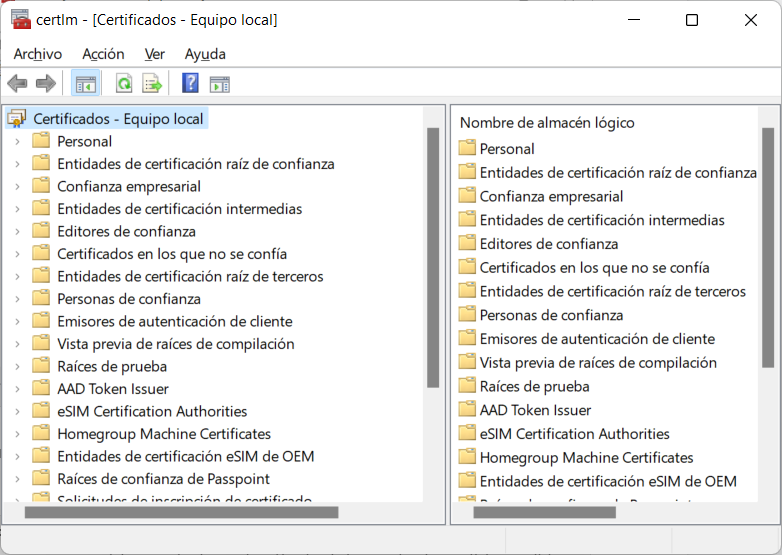

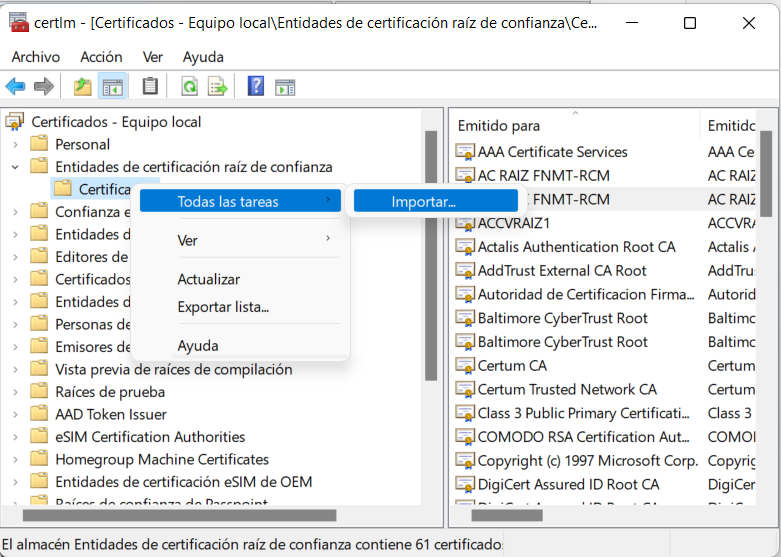

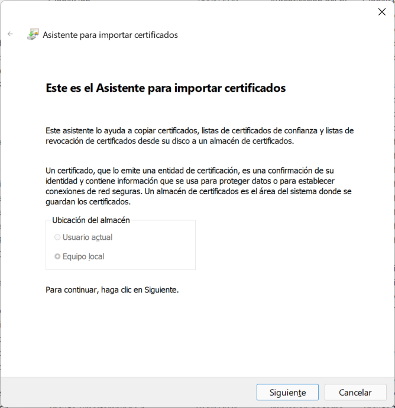

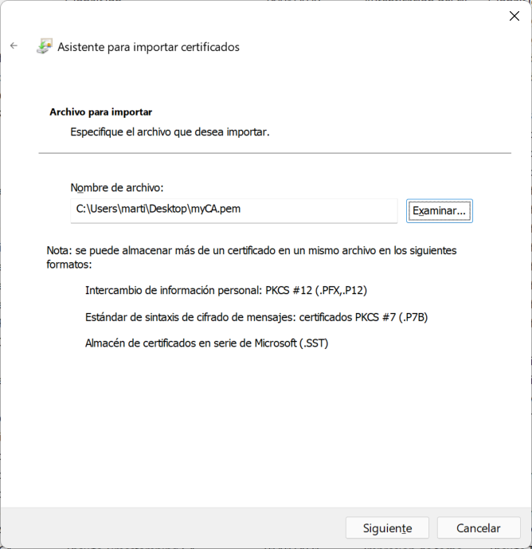

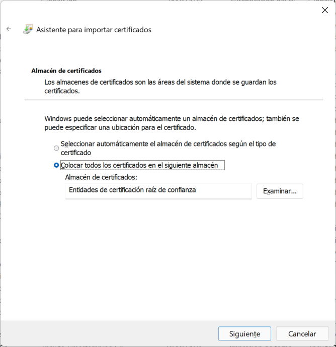

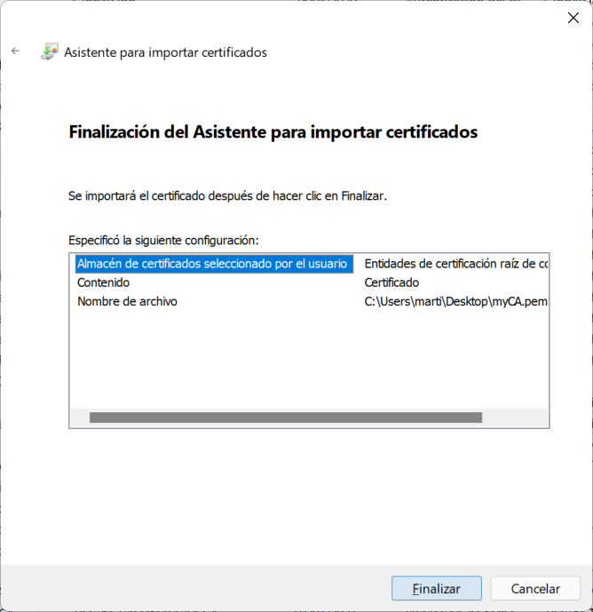

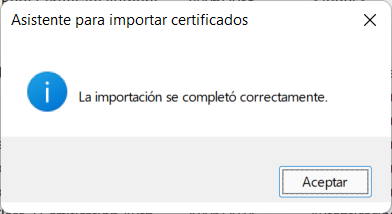

### 1.3 Instal·lar el certificat arrel a Firefox

Firefox pot utilitzar el seu propi magatzem de certificats. Per importar-hi el certificat:

1. Obre el menú de Firefox i entra a **Ajustes**.
2. Ves a **Privacidad y Seguridad**.
3. A l’apartat **Certificados**, prem **Ver certificados**.
4. Amb la pestanya d’autoritats de certificació seleccionada, prem **Importar** i tria `myCA.pem`.

Les captures següents corresponen a la interfície que apareixia al document original; els noms i la posició dels menús poden variar segons la versió del navegador.

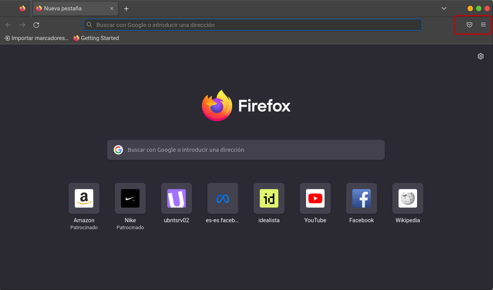

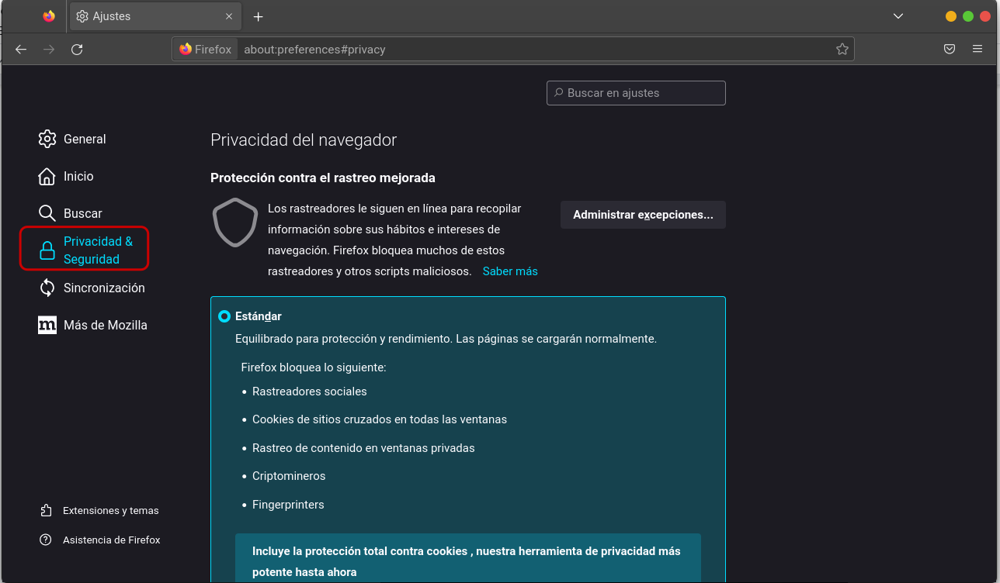

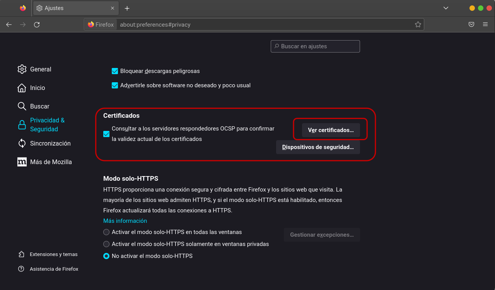

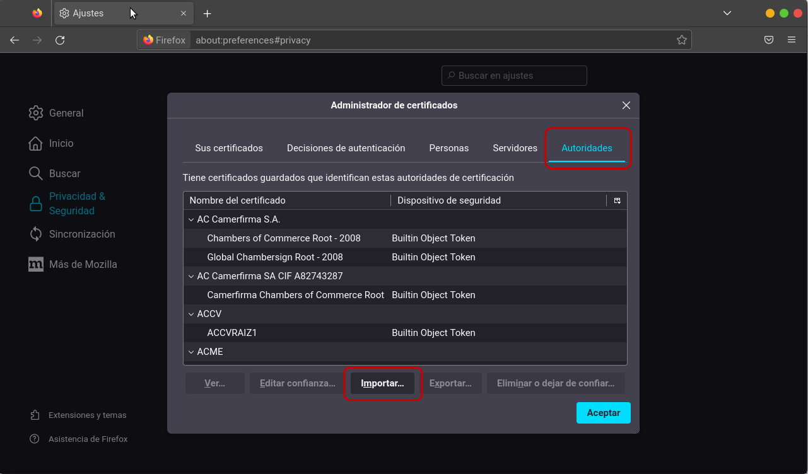

## 2. Crear i signar un certificat per a un servidor web

Un cop el client confia en la CA, aquesta pot signar certificats per a servidors web.

### 2.1 Generar la clau i la CSR del servidor

Genera una clau privada per al servidor. En l’exemple, el nom del fitxer correspon al domini `ubntsrv02.local`:

```bash
openssl genrsa -out ubntsrv02.local.key 2048
```

Crea una sol·licitud de signatura de certificat (CSR):

```bash
openssl req -new -key ubntsrv02.local.key -out ubntsrv02.local.csr
```

Introdueix les dades del servidor quan OpenSSL les demani. El **Common Name** de l’exemple és `ubntsrv02.local`. Els camps opcionals, com ara l’adreça de correu, la contrasenya de repte (*challenge password*) i el nom d’empresa, es poden deixar en blanc per a aquesta pràctica.

La contrasenya de repte és un camp opcional de la CSR; no xifra la clau privada. La protecció de la clau depèn de com s’hagi generat aquesta clau.

### 2.2 Definir el SAN i signar el certificat

Crea el fitxer `ubntsrv02.local.ext` amb aquesta configuració d’extensions:

```ini
authorityKeyIdentifier=keyid,issuer
basicConstraints=CA:FALSE
keyUsage = digitalSignature, nonRepudiation, keyEncipherment, dataEncipherment
subjectAltName = @alt_names

[alt_names]
DNS.1 = ubntsrv02.local
```

El camp `subjectAltName` especifica el nom DNS del servidor que serà vàlid per al certificat.

Signa la CSR amb la CA:

```bash
openssl x509 -req \
  -in ubntsrv02.local.csr \
  -CA myCA.pem \
  -CAkey myCA.key \
  -CAcreateserial \
  -out ubntsrv02.local.crt \
  -days 825 \
  -sha256 \
  -extfile ubntsrv02.local.ext
```

OpenSSL demanarà la contrasenya de `myCA.key`, perquè necessita accedir a la clau privada de la CA per signar el certificat.

Exemple de sortida:

```text
Signature ok
subject=C = SP, ST = Illes Balears, L = Palma de Mallorca, O = IES Emili Darder, OU = Dept TIC, CN = ubntsrv02.local
Getting CA Private Key
Enter pass phrase for myCA.key:
```

### 2.3 Comprovar els fitxers generats

En acabar, la carpeta contindrà fitxers com aquests:

```text
myCA.key                  Clau privada de la CA
myCA.pem                  Certificat arrel de la CA
myCApubkey.pem            Clau pública de la CA (opcional)
myCA.srl                  Número de sèrie creat per OpenSSL
ubntsrv02.local.crt       Certificat del servidor signat per la CA
ubntsrv02.local.csr       Sol·licitud de signatura del certificat
ubntsrv02.local.ext       Configuració d’extensions del certificat
ubntsrv02.local.key       Clau privada del servidor
```

Amb `ubntsrv02.local.crt` i `ubntsrv02.local.key` ja es pot configurar el servidor web perquè ofereixi HTTPS.

## Resum

- La CA necessita una clau privada protegida i un certificat arrel.
- Els clients han de confiar en el certificat arrel per reconèixer els certificats signats per la CA.
- Cada servidor necessita una clau privada i una CSR.
- La CA signa la CSR i emet el certificat del servidor.
- El SAN ha d’incloure el nom DNS que utilitzaran els clients per accedir al servidor.

## Fonts i recursos

- [SSL Certificate Authority for Local HTTPS Development](https://deliciousbrains.com/ssl-certificate-authority-for-local-https-development/)
- [Cryptography basics: OpenSSL, part 2](https://opensource.com/article/19/6/cryptography-basics-openssl-part-2)
- [Gist de sanrandry](https://gist.github.com/sanrandry/bd4350a591f62eb259e48cd9fbfcd642)
- [Habilitar HTTPS en Nginx](https://techexpert.tips/es/nginx-es/habilitar-https-en-nginx/)
- [Crear un certificat autosignat per a Apache a Ubuntu 20.04](https://www.digitalocean.com/community/tutorials/how-to-create-a-self-signed-ssl-certificate-for-apache-en-ubuntu-20-04-es)
- [Configurar una CA a Ubuntu 20.04](https://www.digitalocean.com/community/tutorials/how-to-set-up-and-configure-a-certificate-authority-ca-on-ubuntu-20-04-es)
